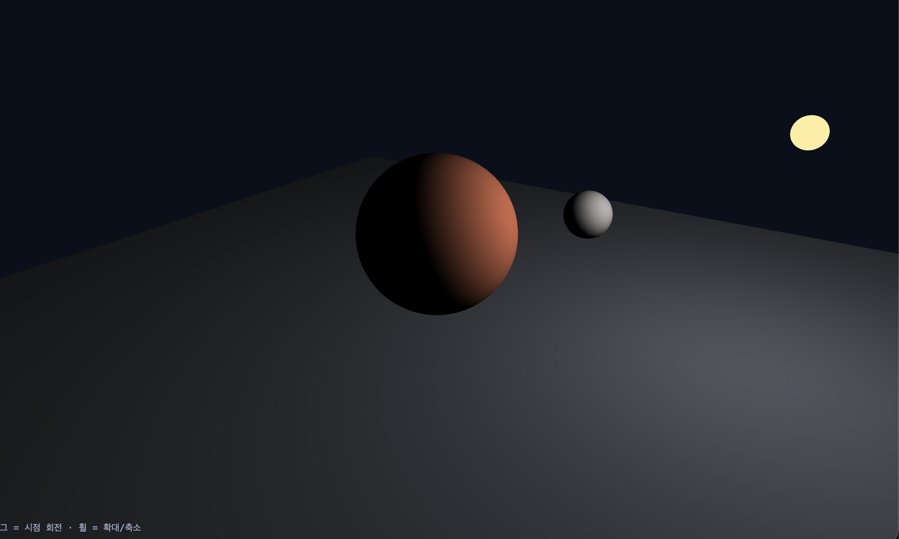
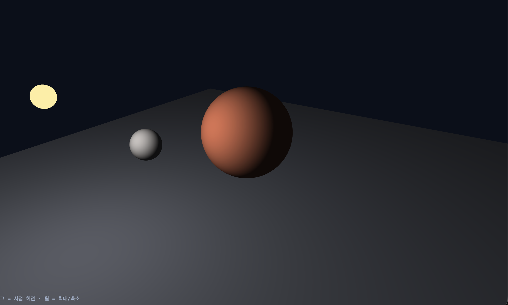
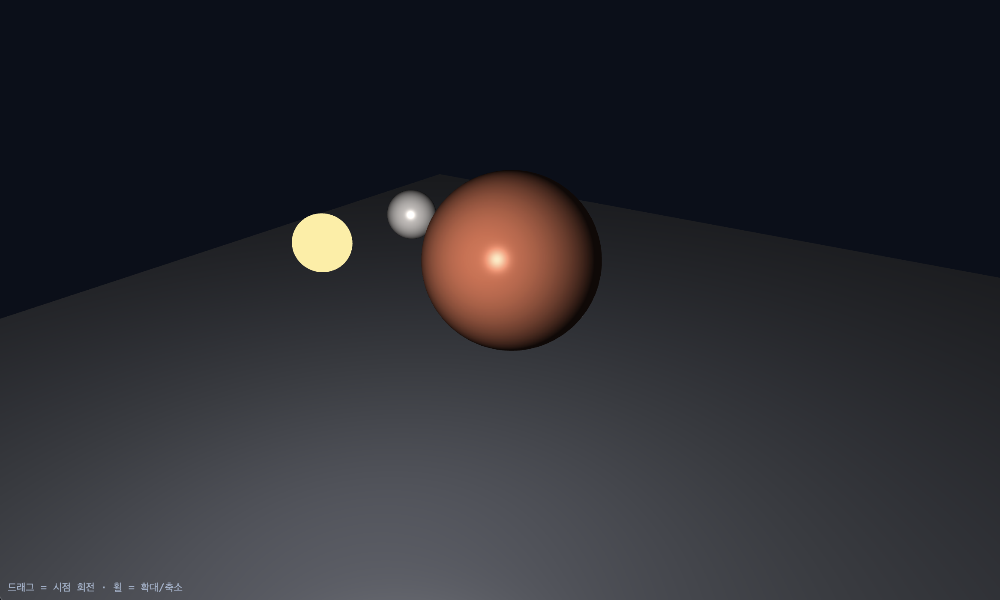
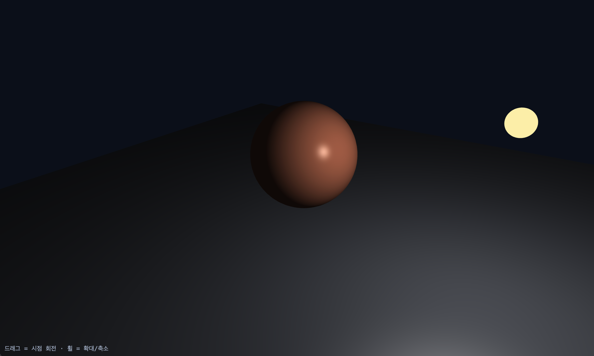
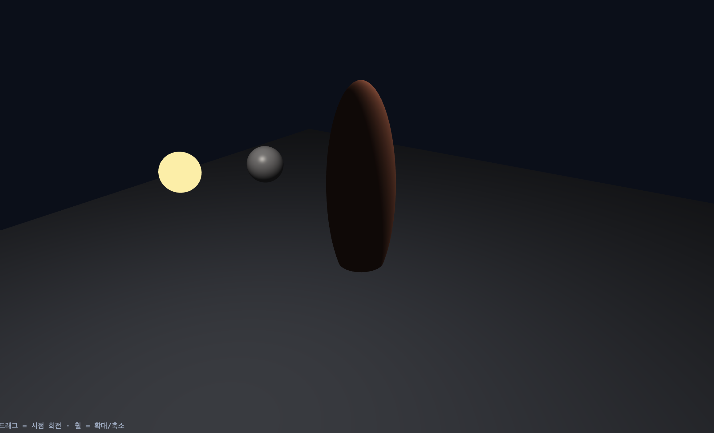
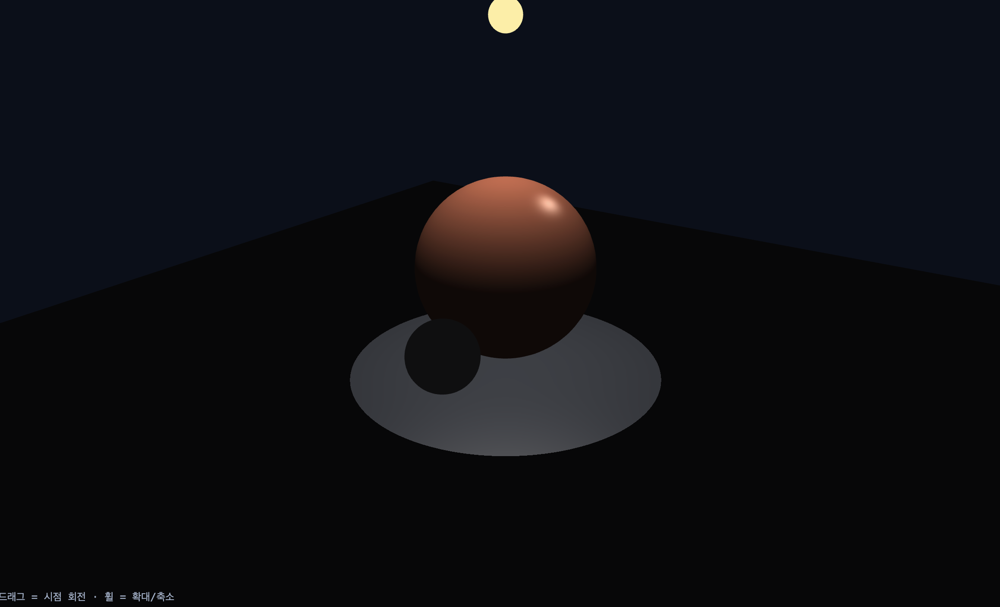
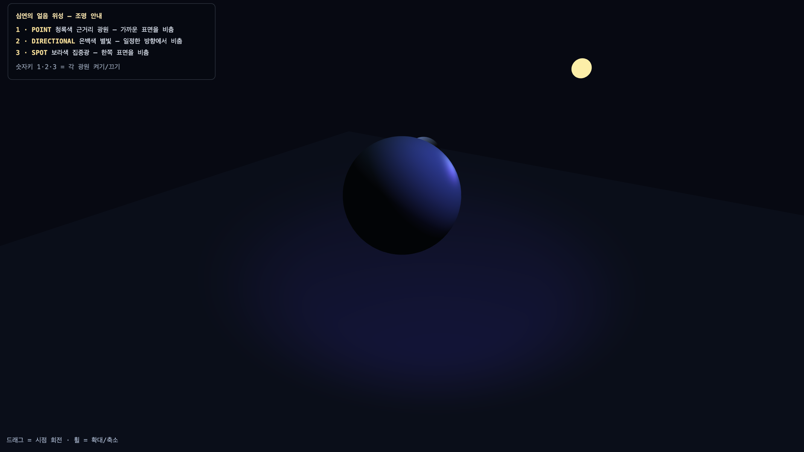
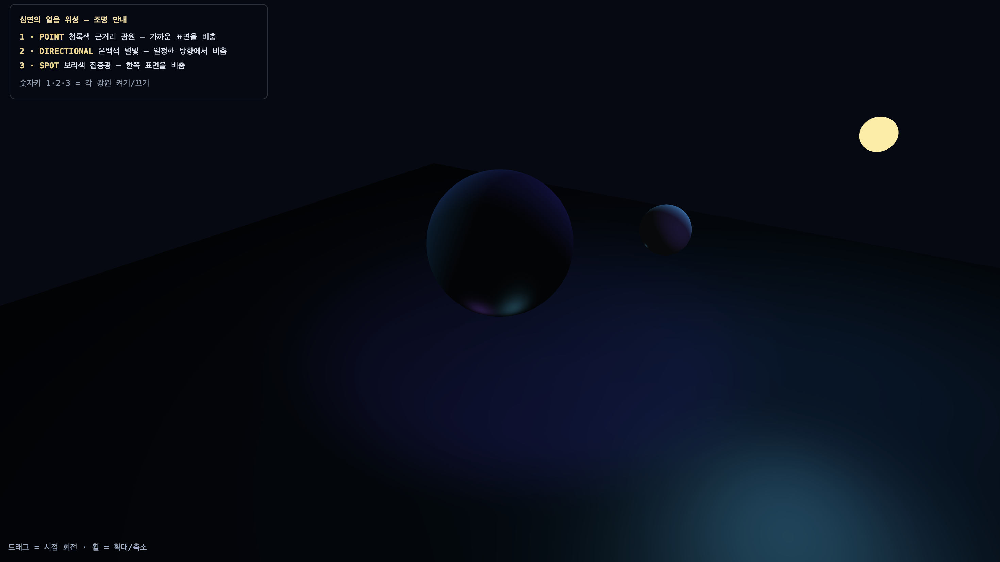
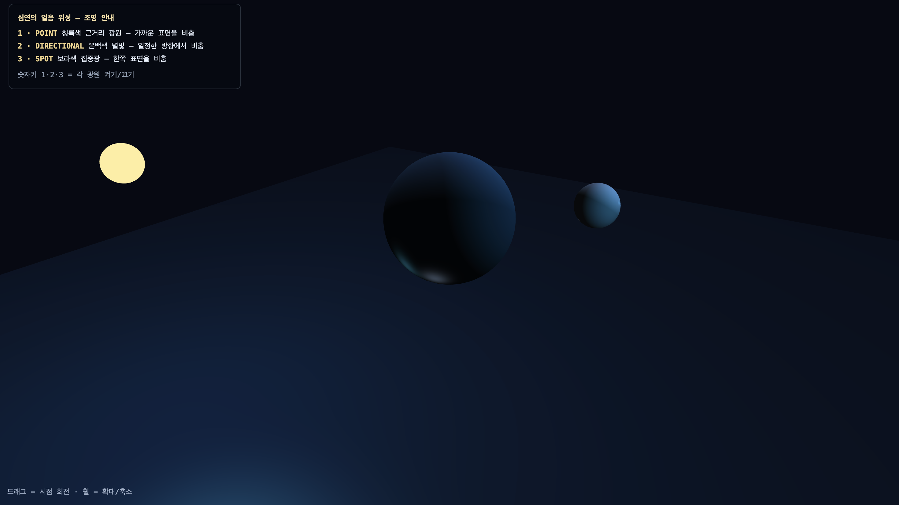
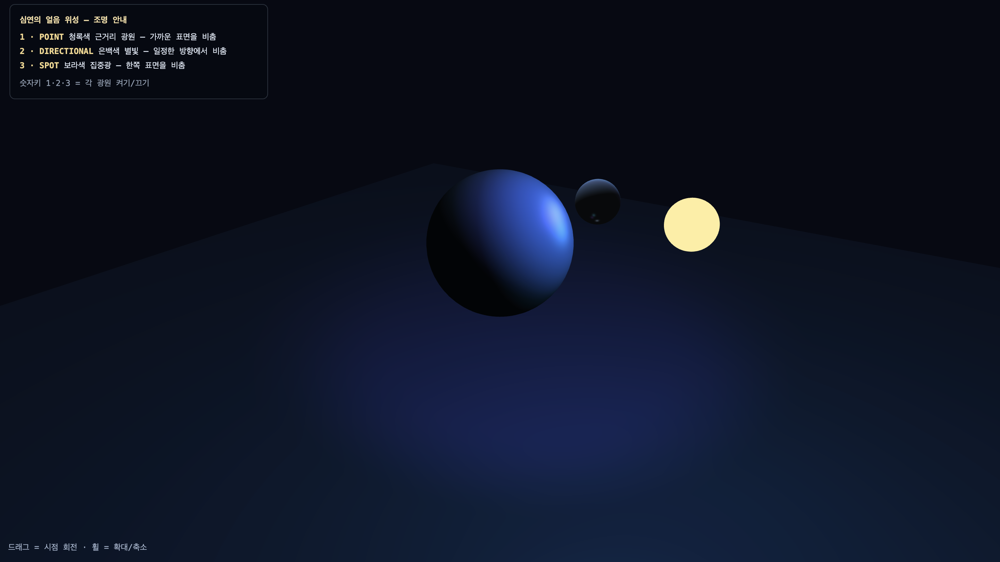

# 5주차 보고서

## 실습 예제 1

### **1. 단계 1~4를 하나씩 적용한 캡처 4장**

1. **확산 반사**

2. **환경광**

3. **정반사**

4. **거리 감쇠**

 

--- 

 

### **2. 단계 1의 max 제거 예측과 실제 결과**
**Max: dot(N,L)과 0.0 중 더 큰 값을 선택해서 음수가 나오지 못하게 막는 역할**

| 예측 | 실제 결과 |
| --- | --- |
| max`를 제거하면 빛을 등진 면에서 `dot(N, L)` 값이 음수가 되어 확산광 계산이 비정상적으로 어두워질 것이라고 예상했다. | `max`를 제거하자 빛을 등진 부분의 `dot(N, L)` 값이 음수가 되어 해당 부분이 검게 나타났다. 광원 자체인 밝은 구는 `uEmissive`로 별도 처리되어 계속 밝게 보였다. |

---

 

### **3. 단계 5의 비교 캡처 2장 — mat3(uModel) 과 uNormalMat, 비균등 스케일 상태에서**
1. **mat3(uModel)**
.png)

2. **uNormalMat**

 

--- 

 

### **4. 단계 6에서 광원 종류를 바꾼 캡처와 무엇이 달라졌는지 한 문단**

- Directional Light로 변경하자 기존 Point Light처럼 광원의 위치에서 빛이 퍼지는 것이 아니라, `모든 물체에 일정한 방향으로 빛이 들어오면서 행성과 달의 밝고 어두운 면이 같은 방향을 기준으로 형성되었다.`

- Spot Light로 변경하고 광원을 위에서 아래로 향하게 설정하자 빛이 장면 전체에 퍼지지 않고 특정 범위에만 집중되었다. 특히 바닥에 원형의 밝은 영역이 나타났으며, 카메라가 바닥을 비스듬히 바라보고 있어 화면에서는 타원 형태로 보였다. 이를 통해 Point Light는 한 위치에서 사방으로 퍼지는 빛, Directional Light는 일정한 방향으로 들어오는 빛, Spot Light는 특정 방향과 범위에 집중되는 빛이라는 차이를 확인할 수 있었다.

 

--- 

 
 
 
 

## 실습 예제 2

### 1. 장면 구현 의도

**주제: 심연의 얼음 위성 (Abyss of the Ice Moon)**

어둡고 차가운 우주 공간에 위치한 얼음 위성을 표현하고자 하였다. 청록색, 은백색, 보라색 계열의 조명을 조합하여 차갑고 신비로운 분위기를 연출하고, 서로 다른 광원과 재질을 활용하여 빛의 방향과 색상에 따라 표면의 모습이 달라지도록 구성하였다.

기존 실습 1의 장면 구조를 바탕으로 중앙 행성을 구형으로 변경하고, 주변의 작은 달과 노란색 광원 표시 구체를 유지하여 총 3개의 구체로 장면을 구성하였다.

### 2. 광원 구성 및 적용 방법

총 3개의 광원을 사용하였으며, Point Light, Directional Light, Spot Light를 각각 적용하였다. 각 광원에 서로 다른 색상을 지정하여 조명 종류에 따른 시각적 차이를 표현하였다.

#### 1 Point Light — 청록색 점광원

- 광원 위치를 중심으로 사방으로 빛이 퍼지는 점광원이다.
- 광원 위치는 시간에 따라 X축과 Z축 좌표가 변하도록 설정하여 중앙 행성 주변을 회전하도록 하였다.
- Y축 높이는 3.6으로 설정하였다.
- 청록색 계열의 색상 `(0.18, 0.78, 0.95)`을 적용하였다.
- 거리 감쇠를 적용하여 광원과 물체 사이의 거리에 따라 빛의 세기가 감소하도록 하였다.

#### 2 Directional Light — 은백색 방향광

- 특정 위치에서 빛이 퍼지는 방식이 아니라 일정한 방향으로 평행하게 들어오는 방향광이다.
- 방향 벡터는 `(-0.65, -1.0, -0.35)`로 설정하였다.
- 은백색과 푸른색 계열의 색상 `(0.68, 0.82, 1.0)`을 적용하였다.
- 광원과 물체 사이의 거리에 영향을 받지 않고 일정한 방향으로 빛이 적용되도록 구성하였다.

#### 3 Spot Light — 보라색 스포트라이트

- 특정 위치에서 일정한 방향과 범위로 빛을 집중시키는 스포트라이트이다.
- 광원 위치는 `(2.5, 5.0, 2.5)`로 설정하였다.
- 빛이 향하는 방향은 `(-0.35, -1.0, -0.45)`로 설정하였다.
- 보라색 계열의 색상 `(0.58, 0.30, 0.95)`을 적용하여 특정 영역에 집중되는 조명 효과를 표현하였다.

### 3. 물체별 재질 차이 적용

각 물체의 표면 특성이 다르게 나타나도록 Base Color와 Shininess 값을 구분하여 적용하였다.

| 물체 | Base Color | Shininess | 재질 표현 |
| --- | --- | --- | --- |
| 중앙 얼음 행성 | `(0.20, 0.34, 0.48)` | 12 | 어둡고 거친 표면 |
| 주변 달 | `(0.68, 0.80, 0.94)` | 96 | 밝고 반사광이 강한 표면 |
| 바닥 | `(0.10, 0.13, 0.20)` | 10 | 어두운 남색 표면 |

- 중앙 행성은 낮은 Shininess 값을 적용하여 정반사가 넓고 약하게 나타나도록 하였다.
- 주변 달은 높은 Shininess 값을 적용하여 정반사가 좁고 선명하게 나타나도록 하였다.
- 바닥은 어두운 남색과 낮은 Shininess 값을 사용하여 전체적인 우주 공간의 분위기를 유지하였다.

### 4. 광원 개별 ON/OFF 기능 및 비교

각 광원의 영향을 독립적으로 확인할 수 있도록 키보드 숫자키를 이용한 ON/OFF 기능을 구현하였다.

| 키보드 | 광원 | 기능 |
| --- | --- | --- |
| 1 | Point Light | 청록색 점광원 ON/OFF |
| 2 | Directional Light | 은백색 방향광 ON/OFF |
| 3 | Spot Light | 보라색 스포트라이트 ON/OFF |

#### 1 Point Light OFF

1번 키를 눌러 Point Light만 비활성화하였다. 이를 통해 주변에서 회전하며 비추는 청록색 점광원이 장면의 밝기와 색상에 미치는 영향을 확인하였다.

#### 2 Directional Light OFF

2번 키를 눌러 Directional Light만 비활성화하였다. 이를 통해 일정한 방향에서 들어오는 은백색 조명이 물체의 밝고 어두운 면을 형성하는 데 미치는 영향을 확인하였다.

#### 3 Spot Light OFF

3번 키를 눌러 Spot Light만 비활성화하였다. 이를 통해 특정 방향과 범위에 집중되는 보라색 조명이 장면의 일부 영역에 미치는 영향을 확인하였다.

각 광원은 서로 독립적으로 켜고 끌 수 있도록 구현하였으며, 하나의 광원을 비활성화하더라도 나머지 광원은 계속 작동하도록 구성하였다.

### 5. 최종 구현 결과

세 가지 광원을 모두 활성화한 최종 장면이다. 청록색 Point Light, 은백색 Directional Light, 보라색 Spot Light가 함께 적용되어 얼음 위성의 차갑고 신비로운 분위기를 표현하였다.

기존 실습 1의 세 구체 구조를 유지하면서 중앙 행성을 구형으로 변경하였으며, 별도의 광원 표시 구체를 추가하지 않고 기존 노란색 광원 표시 구체를 유지하였다.

### 6. AI 활용 내역

이번 실습에서는 AI를 활용하여 기존 실습 1의 코드를 바탕으로 새로운 조명 장면을 구현하고, 코드의 수정 및 오류 확인에 도움을 받았다.

**AI에게 요청한 내용**
- 기존 장면을 활용하여 '심연의 얼음 위성'이라는 주제의 새로운 조명 환경 구성 구체화 요청
- Point Light, Directional Light, Spot Light 총 3종류의 광원 적용
- 각 광원에 서로 다른 색상을 지정하여 조명 효과 구분
- 키보드 숫자키 1, 2, 3을 이용한 광원별 개별 ON/OFF 기능 구현 오류 검토
- 물체마다 Base Color와 Shininess 값을 다르게 설정하여 재질 차이 표현

**직접 확인하고 수정한 내용**
- 기존 노란색 광원 표시 구체가 Point Light를 비활성화해도 사라지지 않도록 수정하였다.
- 추가 광원은 별도의 구체로 표시하지 않고 조명 계산에만 참여하도록 구성하였다.
- 광원별 색상과 위치, 방향을 확인하고 최종 장면의 시각적 표현을 조정하였다.

