# 6주차 컴퓨터그래픽스 실습 보고서
## PBR 재질 구현 및 행성 환경에 따른 표면 변화

---

# 1. 실습 1 — 단계별 재질 만들기

## 1.1 실습 목표

기존 큐브에 텍스처와 PBR 조명 모델을 적용하여 물체의 표면 재질을 표현하였다.

단계별로 Base Color, PBR 직접광, ARM 텍스처, Normal Map, Environment Map을 추가하고 각 요소가 화면에 미치는 영향을 확인하였다.

## 1.2 구현 내용

### (1) Base Color 텍스처

Color 텍스처를 불러와 물체의 기본 색상으로 적용하였다. 텍스처의 RGB 값을 sRGB에서 Linear 색상 공간으로 변환하여 조명 계산에 사용하였다.

### (2) 직접광 PBR

GGX 기반의 PBR 조명 모델을 구현하였다.

- D(GGX): 미세면 분포 함수
- F(Schlick): Fresnel 반사 함수
- G(Smith-Schlick): 기하학적 감쇠 함수

기존 Phong 조명 대신 직접광 PBR 계산을 적용하고 Ambient 항을 추가하였다.

### (3) ARM 텍스처

ARM 텍스처의 각 채널을 다음과 같이 사용하였다.

- R: Ambient Occlusion
- G: Roughness
- B: Metallic

각 텍스처 값을 슬라이더 배율과 연결하여 재질 특성을 조절할 수 있도록 구현하였다.

### (4) Normal Map

Normal Map을 이용하여 물체 표면의 미세한 요철을 표현하였다.

화면 공간의 위치 및 UV 변화량으로 TBN 행렬을 계산하고, 접선 공간 법선을 적용하였다.

### (5) Environment Map

반사 방향을 계산하여 환경 파노라마 텍스처를 조회하였다.

Roughness 값에 따라 환경맵의 Mipmap 레벨을 조정하여 재질의 거칠기에 따른 반사 차이를 표현하였다.

## 1.3 실습 결과

### 기본 텍스처 적용

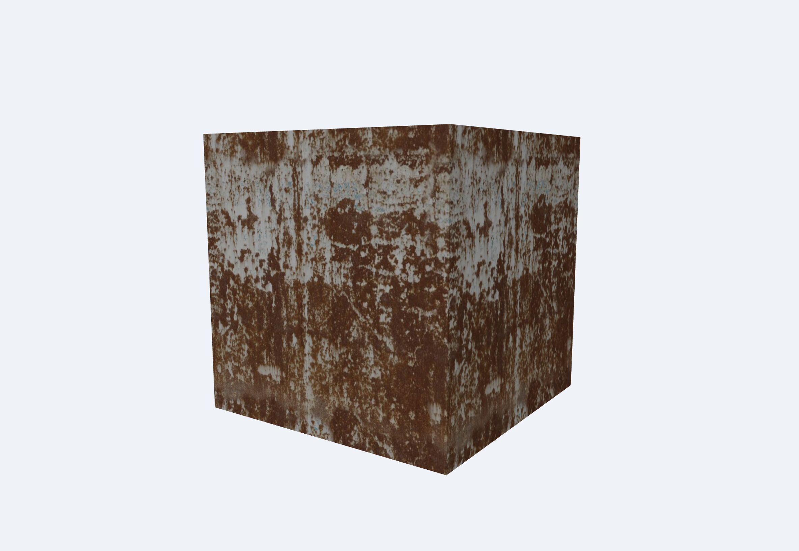

### ARM 텍스처 적용

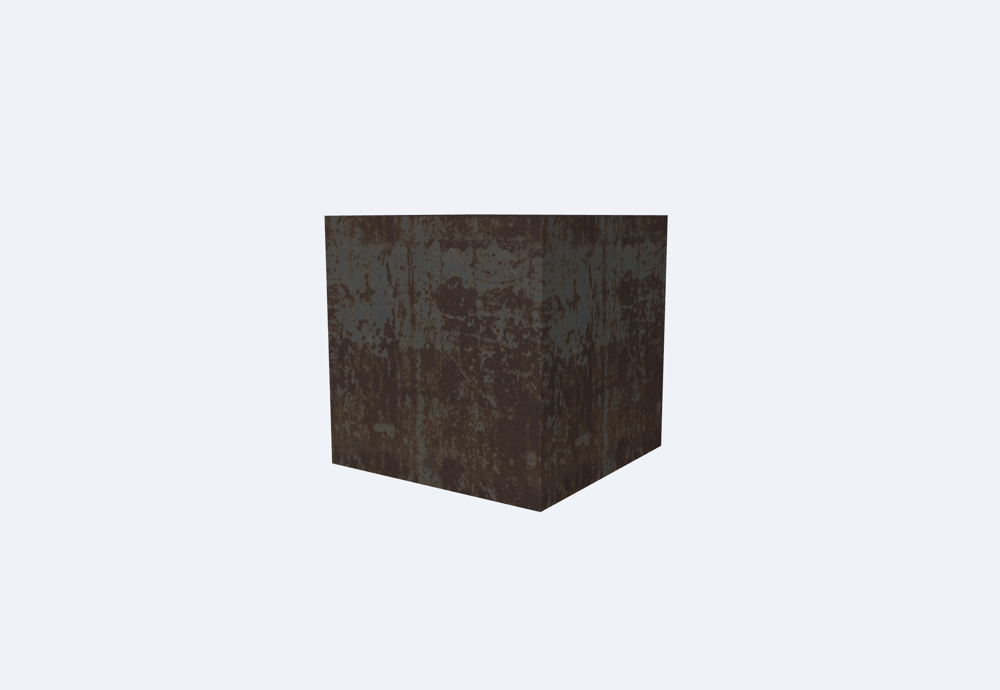

### Normal Map 적용

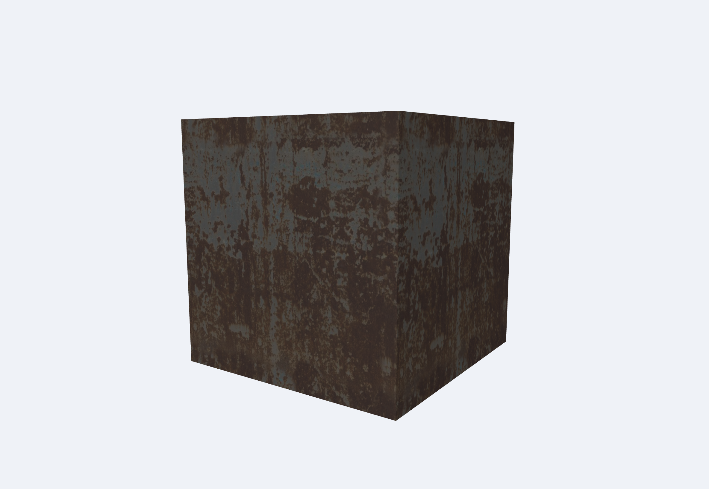

### 금속 재질 및 녹 표면 비교

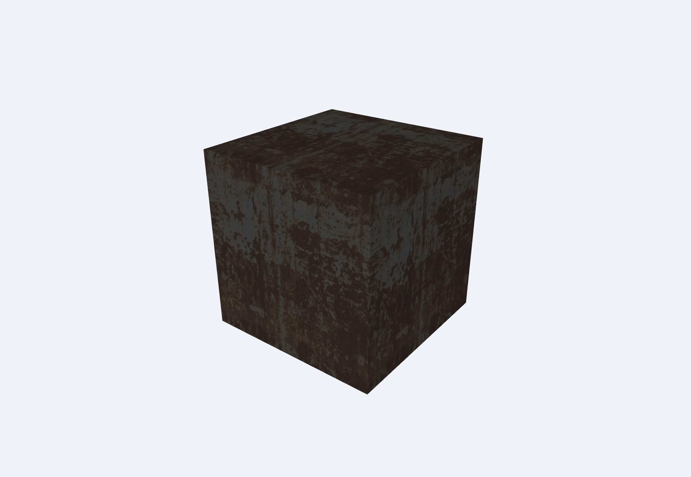

### 텍스처 필터링 비교

Nearest 필터링을 적용한 결과이다.

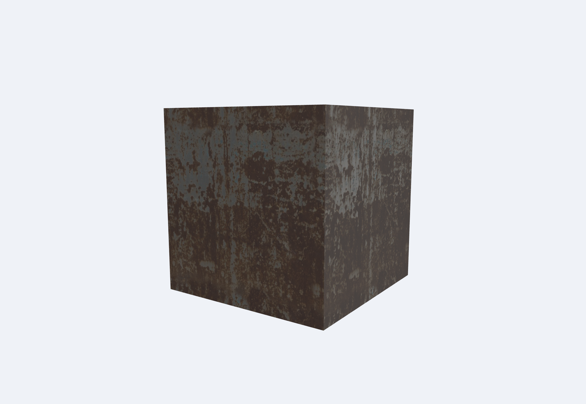

Trilinear 필터링을 적용한 결과이다.

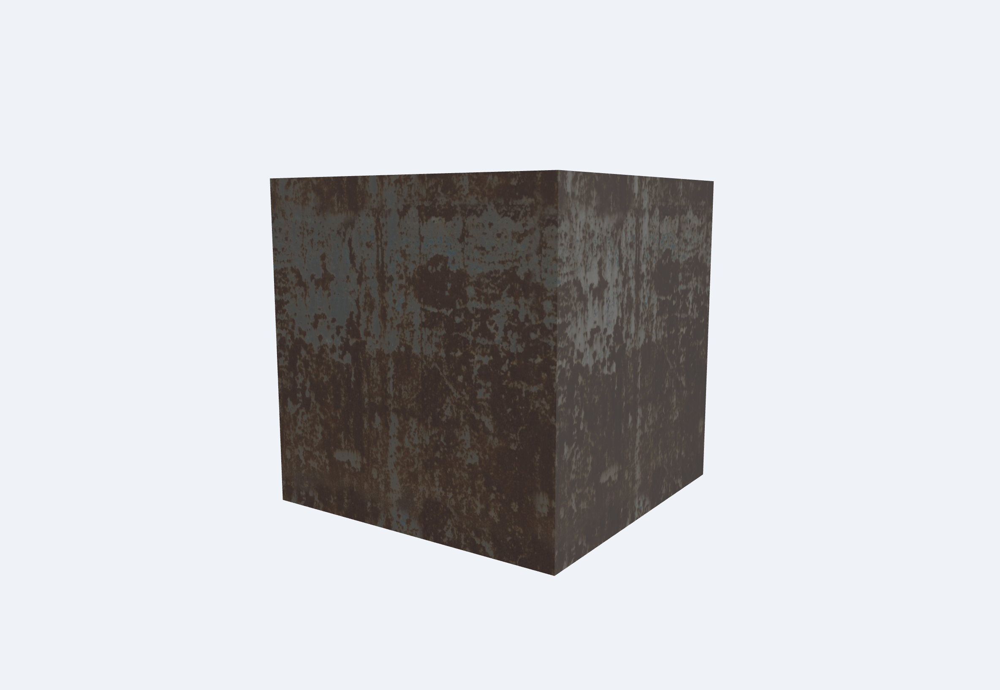

### 조명 비활성화 확인

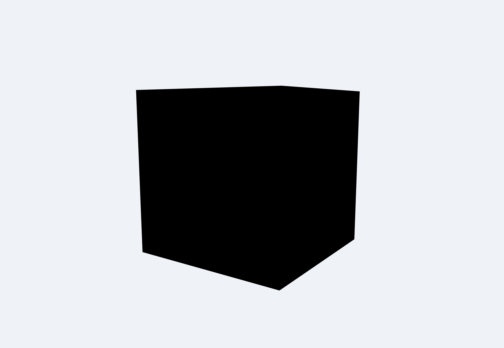

---

# 2. 실습 2 — 행성 환경과 표면 변화

## 2.1 행성 콘셉트

### ABYSS-9 (아비스-9)

극저온 환경에 위치한 얼음 위성을 주제로 행성을 설계하였다.

행성 표면은 암석과 얼음으로 구성되며, 항성과의 거리 및 극저온 화산 활동이라는 두 가지 환경 조건에 따라 표면의 형태와 재질이 변화하도록 구성하였다.

## 2.2 태양계 장면 구현

기존 큐브 메시를 UV 좌표가 포함된 구형 메시로 변경하여 행성을 구현하였다.

구형 메시에는 다음 데이터를 사용하였다.

- Position: 정점 위치
- Normal: 표면 법선
- UV: 텍스처 좌표
- Index: 삼각형 인덱스

태양은 발광 셰이더를 이용하여 자체적으로 빛을 내는 물체로 표현하였다.

행성에는 Y축 회전 행렬을 적용하여 자전하도록 하였으며, 행성의 위치와 법선에 동일한 회전 변환을 적용하였다.

기존 실습 1에서 구현한 PBR, ARM, Normal Map 및 Environment Map 계산도 유지하였다.

## 2.3 첫 번째 환경 조건 — 항성과의 거리

첫 번째 조건은 항성과 행성 사이의 거리이다.

거리 슬라이더를 0부터 100까지 조절할 수 있도록 구현하였다.

항성과의 거리가 변하면 다음 요소가 함께 변화한다.

1. 태양의 위치
2. 행성에 적용되는 직접광의 세기
3. 행성 극지방의 얼음 영역

태양과의 거리에 따른 직접광 감쇠는 역제곱 법칙을 이용하였다.

행성의 로컬 좌표에서 Y축 값을 이용하여 극지방을 판별하고, 항성과의 거리에 따라 얼음 영역의 경계가 달라지도록 마스크를 계산하였다.

얼음 영역에는 청백색 계열의 Base Color를 적용하고 Roughness를 낮추어 상대적으로 매끄럽고 반사되는 표면을 표현하였다.

### 항성과의 거리 변화 결과

거리 100: 항성과 먼 상태

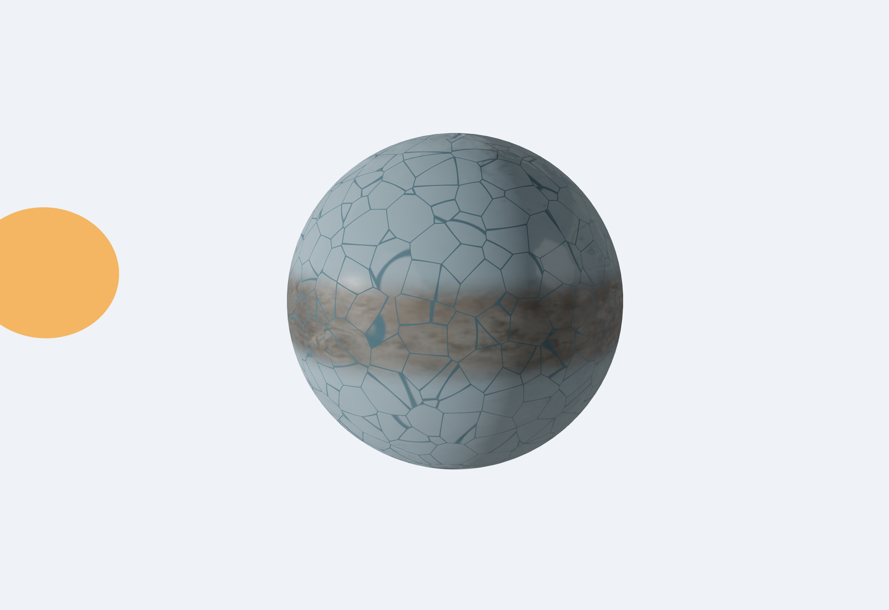

거리 50: 중간 거리 상태

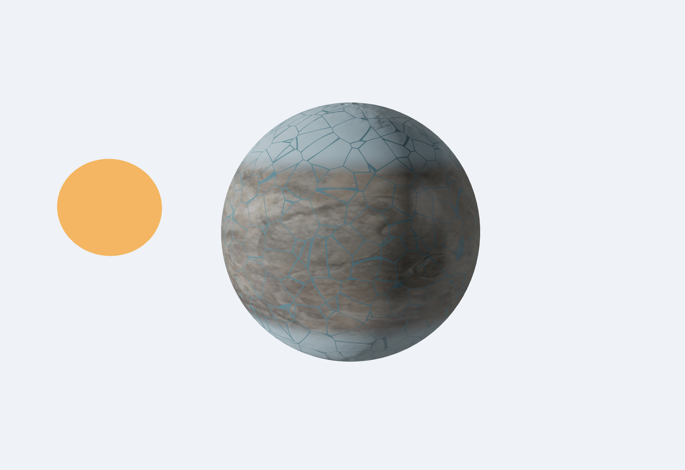

거리 0: 항성과 가까운 상태

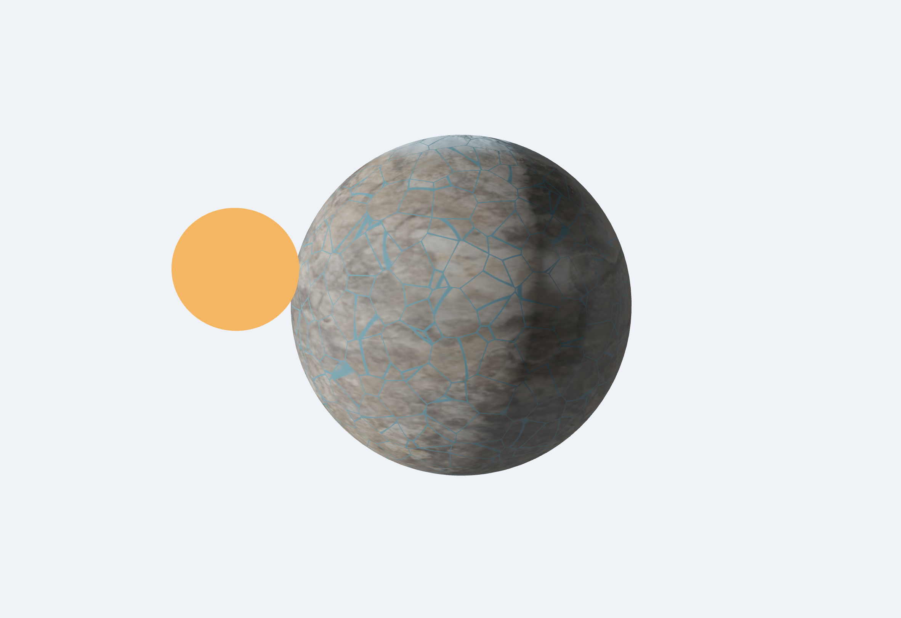

## 2.4 두 번째 환경 조건 — 극저온 화산 활동

두 번째 조건은 극저온 화산 활동이다.

첫 번째 조건인 항성과의 거리와 독립적으로 작동하도록 별도의 슬라이더를 구성하였다.

3D Voronoi 패턴을 이용하여 행성 표면에 불규칙한 균열을 생성하였다.

화산 활동 값에 따라 균열의 밀도와 폭이 변화하도록 구현하였다.

균열 영역에는 청록색 계열의 어두운 색상을 적용하였으며, Roughness와 Metallic 값을 함께 조절하여 주변 표면과 다른 재질 특성을 갖도록 하였다.

이를 통해 색상 변화뿐 아니라 표면의 반사 특성에도 차이가 나타나도록 하였다.

## 2.5 두 마스크와 PBR 재질 연결

### 마스크 1: 얼음 영역

행성의 로컬 위치와 위도를 이용하여 극지방 얼음 영역을 계산하였다.

항성과의 거리가 멀어질수록 얼음 영역이 확대되도록 하였다.

마스크는 Base Color와 Roughness에 연결하였다.

### 마스크 2: 화산 균열 영역

3D Voronoi 경계선을 이용하여 표면의 균열을 계산하였다.

화산 활동이 증가할수록 균열의 밀도와 폭이 증가하도록 하였다.

마스크는 Base Color, Roughness 및 Metallic에 연결하였다.

두 마스크 모두 행성의 로컬 좌표를 기준으로 계산하여 행성이 자전해도 표면 패턴이 행성에 붙어 있도록 구성하였다.

## 2.6 기본 표면과 변화한 표면 비교

기본 암석 표면과 환경 조건이 적용된 행성을 동일한 장면에서 비교하였다.

왼쪽 행성에는 환경 변화 마스크를 적용하지 않고, 오른쪽 행성에는 현재 설정된 항성 거리와 화산 활동 조건을 적용하였다.

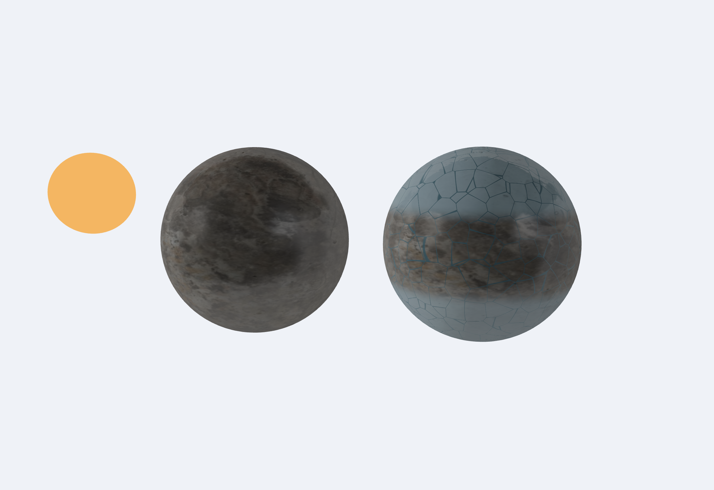

---

# 3. 구현 결과 및 고찰

이번 실습에서는 PBR 재질을 단계별로 구현하고, 이를 구형 행성에 적용하여 환경 조건에 따른 표면 변화를 표현하였다.

실습 1에서는 Base Color, ARM, Normal Map, Environment Map을 활용하여 기본적인 물리 기반 재질 표현을 구현하였다.

실습 2에서는 행성의 표면 위치를 기반으로 두 가지 마스크를 계산하였다.

첫 번째 마스크는 항성과의 거리에 따른 극지방 얼음 영역을 표현하였으며, 두 번째 마스크는 극저온 화산 활동에 따른 불규칙한 균열을 표현하였다.

또한 두 마스크를 Base Color와 Roughness, Metallic에 연결하여 단순한 색상 변화가 아닌 표면 재질의 차이도 나타내고자 하였다.

기존 실습의 PBR 및 Normal Map 코드를 유지하면서 새로운 환경 조건을 추가하였다는 점에서 셰이더의 각 요소가 재질 표현에 미치는 영향을 이해할 수 있었다.

## 4. 사용 기술

- JavaScript
- WebGL 2.0
- GLSL ES 3.00
- PBR
- GGX
- Schlick Fresnel
- Smith-Schlick Geometry
- ARM Texture
- Normal Mapping
- Environment Mapping
- UV Sphere Mesh
- Voronoi Pattern
- Procedural Mask

---
